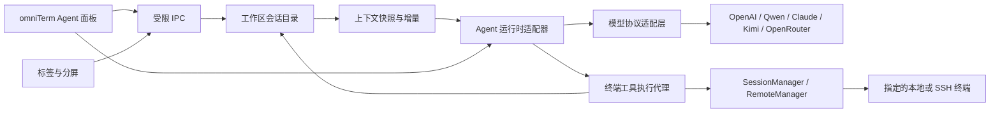

# 下一阶段开发方案：omniTerm Agent 工作区

日期：2026-10-30。基线：已发布的 0.0.1，主分支提交 `78ac872c82`。
状态：开发方案，不代表 0.0.1 已支持。实现进度、与方案的差异和验证范围见
[实现状态](agent-workspace-status.md)。

本阶段的核心交付是：**Agent 知道用户打开了哪些终端，能理解一个或多个指定终端的上下文，
并且始终清楚自己获准操作的是哪个终端。** 产品入口统一叫 **omniTerm Agent**，
同时接入用户自己的 Qwen、Claude、Kimi、OpenRouter 等模型服务。

## 1. 产品目标与演示场景

打开三个终端：A 是本地项目，B 是测试机 SSH，C 是另一个 SSH 会话。
用户对 omniTerm Agent 说：“结合 A 的构建错误和 B 的日志排查问题，只在 B 上执行检查。”

交付后的行为：

1. Agent 能列出 A/B/C 的类型、状态和所属标签/分屏，知道当前焦点；界面显示这些信息的来源。
2. 用户选择 A+B 后，Agent 自动获取它们的相关输出和可确认的环境信息，无需逐段复制粘贴。
3. 回答引用具体终端和输出片段，能区分本地目录与远程目录；不知道的状态明确标为未知。
4. 操作卡片明确写出“执行于 B / 测试机”，用户批准后只向 B 发送对应操作。
5. 用户切换到 C 不会改变本轮目标；B 关闭或重新连接后，旧操作失效，不会落到另一个窗口。
6. 更换为 Qwen、Claude、Kimi 或 OpenRouter 配置后，仍使用同一套上下文、目标和工具规则。

这里的“终端窗口”先覆盖 **omniTerm 内的标签页与分屏**。数据结构预留应用窗口 ID，
避免将来增加多窗口时串线；本阶段不采集其他终端软件的窗口。

## 2. 0.0.1 的基础与缺口

| 现有入口 | 可以复用的基础 | 本阶段需要补齐 |
| --- | --- | --- |
| `electron/session-manager.mjs` | UUID、PTY 生命周期、每会话最多 2 MiB 原始输出 | 会话清单、输出序号、截断信息、连接代次、命令状态与 Agent 专用接口 |
| `src/App.jsx`、`src/layout.js` | 标签/分屏、焦点、名称与布局 | 将布局和焦点同步到可信工作区目录；建立上下文选择与固定执行目标 |
| `src/TerminalView.jsx` | xterm 屏幕、选区、标题、OSC 7 目录事件 | 语义快照、命令边界、可靠性标记；避免把标题或控制序列当作授权依据 |
| `electron/main.mjs`、`preload.cjs` | 受限 IPC、会话读写、调用方校验 | 独立的 Agent 上下文服务、执行代理与授权校验 |
| `electron/remote-manager.mjs` | 受管理 SSH 连接、SFTP 与主机指标 | 将连接身份与终端 ID 关联，明确远端环境与当前交互状态 |
| `codex-rs/app-server*` | 结构化线程、回合、流式事件、审批、取消及客户端工具协议 | 实际接入桌面、锁定协议版本，并验证实验性动态工具能力 |
| `codex-rs/model-provider-info`、`codex-rs/core` | 提供商配置、认证及 Responses 客户端 | Chat Completions / Anthropic Messages 适配与跨协议工具语义 |

当前 `startAgent()` 创建独立 PTY，`sendSelectionToAgent()` 只是把选中文字粘贴进 TUI。
窗口清单、上下文持续更新和目标绑定都没有因此建立。

两个实现细节必须修正：SSH 进程的启动 `cwd` 是**本地**目录，不能当成远端目录；
当前 descriptor 的 `remote` 标记取决于文件/指标面板是否启用，不能据此判断会话是否远程。

## 3. 上下文与目标的交互设计

Agent 面板顶部长期展示三项：**上下文范围、执行目标、供应商 / 模型**。
提供终端选择器和 `@终端` 引用；同名窗口通过主机、目录、标签路径和短 ID 区分。

| 项目 | 默认行为 | 用户可调整的行为 |
| --- | --- | --- |
| 工作区感知 | 本地维护全部打开终端的清单；任务开始时提供必要的清单和焦点信息 | 清单中的敏感名称可隐藏；不包含密码、密钥或完整环境变量 |
| 上下文范围 | 发起任务时，自动附带所选当前终端的有界近期上下文，并显示共享范围 | 选一个、多个或全部当前终端；固定某组；只共享选区；排除某会话 |
| 执行目标 | 发起本轮时选定并固定具体终端；读取多个终端不扩大写入权限 | 明确选择另一个目标，或创建逐目标列出的批量操作 |
| 实时更新 | 已选范围在后续回合按需读取增量；显示采集时间和缺失范围 | 暂停共享、移除上下文、调整输出预算 |
| 新终端与切焦点 | 更新工作区清单；新终端正文不自动加入旧任务，焦点不改变在途操作 | 下一轮显式选取新上下文或新目标 |

窗口清单在本机持续更新，不持续上传所有终端输出。发送任务时应能直接看到本轮将共享哪些
终端、输出范围及目标模型服务；选定范围内的正常读取不需要反复弹窗。

暂停共享或移除终端后停止新采集，但已发送给模型服务的内容无法收回，且可能仍在引擎线程历史中。
若后续请求必须排除该终端的旧内容，创建清理后的新线程，或使用经用户确认且不含该终端内容的摘要；
不能继续重发旧历史却宣称已经移除上下文。

上下文至少包含：终端 ID、会话类型、连接状态、标签/分屏位置、主机与用户、目录、
选区、近期输出、最近命令与退出状态，以及这些信息的来源、时间和可信程度。
字段只在确实可获取时填写；缺少 shell integration 时不能编造当前命令、退出码或远端目录。

每段输出附会话 ID、连接代次、序号区间和截断标记。模型回答中的引用可以定位到来源终端；
历史已被缓冲淘汰时显示缺失，不补造内容。上下文构建按每终端和总预算裁剪，优先保留选区、
失败命令及相关尾部输出，并明确告诉模型哪些内容没有提供。

原始 PTY 数据不等于屏幕和命令历史：回车覆盖、退格、光标移动、备用屏幕及全屏程序需要
终端解析器处理。建立可测试的屏幕快照/输出增量服务，不能仅删除 ANSI 转义序列后拼成长文本。
初始预算可从“每终端 200 行、任务正文合计 64 KiB”起步，另计协议和提示词，并按模型预算校验；
系统提示、聊天历史、工具结果和输出预留共同计入模型令牌预算；这是待实测调整的起点。

## 4. 结构化 Agent 与终端工具

默认 Agent 面板改为 React 对话与任务界面，承载消息、上下文引用、工具卡片、执行结果、
审批和取消。底层先复用现有 Rust 引擎，通过 app-server 适配器连接；TUI 不再承担默认产品界面。
本阶段继续使用现有 Electron/xterm.js 桌面与 PTY，不同时启动整套原生 Rust 界面重写。

图中的 UI 到运行时关系均通过主进程 IPC 实现；renderer 不直接获取密钥或调用任意进程。

### 会话与操作标识

- **会话引用：** `windowId + sessionId + connectionEpoch`。标题、标签序号和主机别名只用于展示。
- **上下文快照：** `snapshotId + selectedSessionRefs + outputSeqRanges + observedAt`，记录截断和未知字段。
- **操作请求：** `operationId + taskId + targetRef + interactionRevision + action + payloadHash`。
- **授权记录：** 绑定操作内容、目标、权限范围与有效期；执行前由主进程重新校验，模型不能自授权限。

`connectionEpoch` 在重新连接/替换底层进程时变化。用户输入、接管或交互模式改变要更新
`interactionRevision`；大量正常输出只推进输出序号，避免因为每次日志刷新而使所有操作失效。

### 工具边界

以下是拟定的产品工具，不宣称它们已存在于当前协议中：

| 工具 | 行为与约束 |
| --- | --- |
| `workspace.list_terminals` | 返回经过权限过滤的窗口清单与状态，不附带全部滚屏 |
| `terminal.read_context` | 读取已选会话的快照/增量；必须携带会话引用、范围与大小限制 |
| `terminal.search_output` | 在获准的有界历史中搜索，返回带来源的片段 |
| `terminal.propose_command` | 生成目标和命令明确的待执行操作卡片；本身不写 PTY |
| `terminal.execute` | 执行已授权且仍有效的操作；返回操作 ID，结果继续按该目标跟踪 |
| `terminal.interrupt` | 中断指定任务在原目标上的操作，不能随当前焦点发送 Ctrl+C |

执行代理必须满足以下规则：

1. 读权限与操作权限分开。首次默认生成操作预览，批准后执行；可提供当前任务、当前目标的
   限时授权。更换目标、撤回权限或会话失效后，旧授权不能复用。
2. 所有 Agent 写入直接经过主进程的目标校验，**不经过 renderer 的广播输入路径**。
   开启人工广播输入也不能扩大 Agent 的操作范围。
3. 判断终端是否可以接受命令，不能只看 PTY 为 running。shell integration 提供就绪/忙碌和
   命令边界；`vim`、`top`、REPL、密码提示或未知状态下，先显示待发送内容并要求明确交互意图。
   无可靠就绪信息时不自动敲回车，可以让用户手动提交或明确创建受管理的新终端。
4. 同一终端的 Agent 写操作串行化，用户可以随时接管。已经排队的请求执行前再次检查目标、
   状态和授权。关闭、退出、重连、接管后不向旧句柄继续写入。
5. 同一个 `operationId` 不重复提交；超时或断线导致结果未知时先核对状态，不自动重放命令。
   应用或引擎重启后，旧批准、排队操作和结果未知的命令不恢复自动执行。
   批量操作逐目标展示结果，不能声称跨主机执行具有原子性。
6. 复用现有 SSH 终端时保留该 shell 的目录和环境。SFTP/control-socket companion 的新 shell
   不等于原窗口，不能悄悄替代；需要新连接时明确创建并显示新的执行目标。
7. 嵌套 SSH、`su`、tmux 等可能使当前交互环境偏离初始连接。无法确认时标为未知并停止自动执行；
   窗口标题和 OSC 内容仅作为观测信息，不能证明主机身份或授予权限。
8. 终端输出、远端日志和文件内容都是待分析数据，其中的指令不能改变上下文范围或工具权限。
   对凭据作尽力脱敏，但不承诺能识别所有秘密；用户仍可预览、排除或暂停共享。

首版执行能力覆盖可确认就绪的本地 shell 与受管理 SSH shell。SFTP、串口、隧道等会话可以提供
获准的上下文，但命令协议各不相同，不能统一发送 shell 命令；它们的写入工具后续单独定义。
Agent 对话本身不加入终端输出采集列表，避免重复摄入自己的消息。

### 引擎接入的首个技术验证

实际启动随包的 app-server，完成初始化、线程/回合、文本流、客户端工具回调、结果回传、审批
和取消。当前 `thread/start.dynamicTools` 标为 experimental，需要锁定协议版本并检测能力。

终端模式的写入能力必须经过上述执行代理。现有 `features.shell_tool` 能禁用部分内置 shell 工具，
但还需审计文件、代码执行和其他环境工具；**单靠提示词要求“只操作 B”不能形成执行边界**。
若当前接口无法限制所有绕行路径，先补齐最小引擎扩展；在约束验证通过前只开放分析与命令预览。
不把“注册了几个动态工具”当作已完成终端权限整合。

## 5. 产品名称统一为 omniTerm Agent

- 面板标题、侧栏、按钮、命令面板、欢迎页、状态栏、错误提示与用户帮助统一使用 **omniTerm Agent**。
- 移除当前 UI 中的 `Codex Agent`、`Codex` 徽标及“由本地 Codex 提供支持”等产品文案。
- 模型栏显示真实供应商与模型，不再把引擎名称当成模型名称。API 请求中的模型标识保留原值。
- 默认使用结构化界面，避免 TUI 自带的标题、帮助和错误不断暴露旧产品品牌；不靠过滤终端字符串
  或全仓库替换 `codex` 来实现更名。
- 内部兼容命令、crate、协议字段和既有配置先保留；上游来源与版权继续保留在 LICENSE、NOTICE
  和第三方声明中。迁移配置或会话历史时不覆盖用户原来的引擎配置。

## 6. 多模型接入

用户可以直接配置自己的 API，不需要先拥有 OpenAI/ChatGPT 账号。保留已有 OpenAI 接入作为
一种选择；产品名称、供应商、模型和底层协议分开建模。

当前 fork 的 `WireApi` 只有 `Responses`，并明确拒绝旧 `wire_api = "chat"`。
已有自定义 `base_url`、认证和请求头能力不等于完整支持其他协议。

| 服务入口 | 接入计划 | 必须单独验证的差异 |
| --- | --- | --- |
| OpenAI | 保留现有 Responses 适配及已有认证路径 | 与新终端工具层整合后的执行和取消行为；其他提供商不依赖它的登录状态 |
| Qwen / 阿里云百炼 | 预设配置；验证 Responses 入口，并实现 Chat Completions 路径 | 地域/工作空间、模型能力、Responses 参数兼容及函数结果回传 |
| Claude / Anthropic | 实现原生 Messages 适配 | 内容块、`tool_use` / `tool_result`、调用 ID、流式参数和停止原因 |
| Kimi / Moonshot | 实现 Chat Completions 适配 | 流式工具参数按调用索引拼接、工具结果及连续回合 |
| OpenRouter | 预设配置；支持 Chat Completions，按能力验证 Responses | 具体模型的工具能力、无状态 Responses 历史、路由后的实际提供商 |
| 自定义服务 | 可选择已实现协议，填写端点与模型 ID | 以能力检测和实测结果标明支持范围，不把所有“兼容”服务标成完整 Agent |

官方资料核对于 2026-10-30：Qwen 的 [Responses 入口](https://help.aliyun.com/zh/model-studio/qwen-api-via-openai-responses)
明确存在兼容差异；Claude 的 [工具接口](https://platform.claude.com/docs/en/agents-and-tools/tool-use/overview)
使用 Messages 语义；Kimi 的 [API 概览](https://www.kimi.ai/help/kimi-api/api-overview)
说明 API 与会员/其他产品的区别。OpenRouter 的 [Responses 文档](https://openrouter.ai/docs/api_reference/responses/overview)
要求无状态请求，`store: true` 或非空 `previous_response_id` 不可直接照搬；
[工具能力](https://openrouter.ai/docs/guides/features/tool-calling) 还取决于具体模型。
这些资料用于设计，不是本项目已完成接入的证明。

### 适配层与配置

默认在 **Rust 模型请求层**扩展 `WireApi`、请求编码和流式事件解析，涉及
`codex-rs/model-provider-info`、`codex-rs/codex-api` 与 `codex-rs/core` 的请求分发。
桌面仍通过 app-server 管理 Agent；仅在 Electron 中包装 app-server 不会增加协议支持。
统一文本增量、工具请求、调用 ID、参数片段、工具结果、用量、结束、错误和取消事件，
并保留现有 OpenAI/Responses 路径的回归验证。

先用最小工具回环验证引擎与新适配器的契约。若技术验证决定改用本地 Responses 兼容桥，
需单独明确启动、访问认证、取消、错误传递和历史管理契约，只实现经过测试的语义。
Chat Completions 和 Messages 是必做适配工作，不以某个厂商提供 Responses 入口代替它们，
也不宣称自动转换任意工具或推理状态。

各协议共用同一套桌面工具定义、授权和目标校验。不能把 freeform/custom 工具、厂商内置工具或
不透明推理数据无条件转换为普通 JSON function。第一阶段优先支持所需的结构化终端工具集合。

设置项包括：配置名称、供应商、协议、Base URL、模型 ID、可选地域/工作空间、凭据引用、
上下文预算、请求超时和已验证能力。支持手填模型 ID；现有引擎的模型目录格式不能直接等同于
所有厂商的 `/models`。分别提供基础连接测试和完整 Agent 工具回环测试。

凭据由系统钥匙串/凭据库保存，主进程按引用取用；不写入 localStorage、普通配置、日志或导出文件，
不加入模型上下文。系统凭据库不可用时提供仅当前会话保存，不静默降级为明文。
ChatGPT、Claude 或 Kimi 的订阅不自动等于各自 API 凭据或额度；Anthropic 直连和 OpenRouter
上的 Claude 也是不同的数据目的地和配置。

每个回合固定供应商、模型与工具授权。切换在回合边界进行，展示将重发的上下文；必要时建立新引擎
线程，不静默向其他提供商发送历史或在失败时跨供应商回退。无工具能力的模型可提供“仅聊天”模式，
不能从回答中的代码块自动提取命令执行。

## 7. 开发顺序与交付门槛

| 批次 | 交付内容 | 进入下一批前的门槛 |
| --- | --- | --- |
| A：接口验证 | 真包 app-server、客户端工具往返、内置工具限制；协议适配最小样例 | 能证明一个工具请求只进入本地执行代理；无法绕过目标；识别不支持的协议能力 |
| B：感知工作区 | 会话目录、焦点同步、快照/增量、原生 Agent 面板、统一名称 | 用真实模型分析一个/多个终端，回答可定位来源，未选正文不会发送 |
| C：操作目标 | 固定目标、操作卡片、授权、命令状态、接管、取消和逐目标结果 | 单终端及多终端任务不串线；断线、重连、关闭、切焦点、广播均不误写 |
| D：多模型 | Qwen、Claude、Kimi、OpenRouter 配置与协议适配，保留 OpenAI | 每家至少一个明确端点/模型完成真实流式与连续工具回环；能力与错误提示准确 |
| E：发布验收 | 三平台 GUI/PTY/SSH 回归、凭据迁移、模型覆盖清单、文档 | 验收记录可复现；已验证与未覆盖组合分开列出；普通终端不依赖模型服务 |

B/C 是最高优先级；D 的协议工作在 A 确认边界后并行推进。更名与原生面板同步完成，
不能把换名称、能聊天或显示一个模型下拉框作为本阶段的完成标准。

拟定实现落点如下；文件名是开发安排，不代表已创建：

| 落点 | 职责 |
| --- | --- |
| `electron/workspace-registry.mjs` | 会话、布局、焦点和连接代次，实际存活状态以主进程为准 |
| `electron/terminal-context.mjs` | 屏幕语义、命令边界、快照、增量与上下文预算 |
| `electron/agent-runtime.mjs` | app-server 子进程、协议版本、线程/回合、流式事件和取消 |
| `electron/agent-terminal-broker.mjs` | Agent 专用工具、授权、固定目标、串行写入和操作记录 |
| `electron/provider-store.mjs` | 模型配置、凭据引用、能力记录与配置迁移 |
| `src/agent/` | 原生对话、上下文选择器、目标提示、工具卡片与模型设置 |
| Rust 模型请求层 | Responses / Chat Completions / Messages 编码和流式协议适配 |

以上桌面路径均相对 `omniterm-desktop/`。复用现有会话、远程连接和布局模块，不重新实现整套终端。

## 8. 必须通过的验收场景

| 场景 | 通过标准 |
| --- | --- |
| 工作区感知 | 终端新建、分屏、重命名、切换、退出与关闭及时反映到目录；同名窗口不混淆 |
| 单/多终端上下文 | A+B 联合分析有来源引用；C 未授权正文不发送；滚屏截断和未知字段明确展示 |
| 撤回上下文 | 停止新采集；需排除旧内容时使用清理后的线程，后续请求不重发旧终端历史 |
| 屏幕语义 | 覆盖 CR 覆写、退格、Unicode、备用屏幕与大量输出；不会把控制序列误认成历史命令 |
| 目标固定 | 选择 B 后切到 A、重排标签或打开人工广播，操作仍只进入 B |
| 目标失效 | 关闭 B 再用同名新建、SSH 重连、用户接管后，旧请求/旧批准被拒绝；应用/引擎重启不自动恢复旧操作 |
| 交互状态 | 忙碌命令、编辑器、REPL、密码提示和未知环境不会被当作空闲 shell 自动提交 |
| 取消与重试 | 取消停止后续操作；中断指向原目标；网络重试不会重复提交副作用命令 |
| 不可信输出 | 日志中要求转向 C 或扩大权限的文本不能绕过执行代理；引擎内置工具不能绕行 |
| 多模型工具循环 | 四家各一个实际模型完成文本、流式、单次及连续两轮工具调用；并行调用仅在声明支持时验收 |
| 协议异常 | 半截/非法工具 JSON 不执行；401/403、429、超时、上下文超限和能力缺失有可行动的提示 |
| 凭据与切换 | 配置导出和日志无密钥；凭据库不可用不明文落盘；供应商切换不复用旧操作批准 |
| 品牌与兼容 | 默认产品流程统一为 omniTerm Agent；原配置可迁移、法务署名保留、上游模型标识不伪造 |
| 三平台真实应用 | macOS、Ubuntu、Windows 各用真实模型完成 GUI → 工具 → 指定 PTY 的回环，并记录实际供应商组合 |

用独立的本地/SSH 测试会话和无害标记命令验证写入落点，避免在业务终端上试错。
单元测试、模拟协议和构建成功只作为前置检查；真实模型接入、真实窗口与真实 PTY 操作分别留证。

本阶段完成意味着用户能在同一个 omniTerm Agent 工作区里完成
**“知道有哪些终端 → 理解选定上下文 → 确认目标 → 执行 → 核对结果”**，且更换模型供应商不会改变这套行为。
