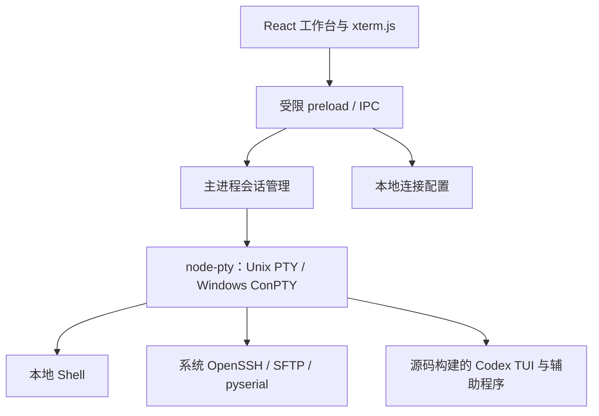

# omniTerm 架构

omniTerm 使用 Electron、React、xterm.js 和 node-pty 实现桌面终端工作台，
将本地终端、远程工具与 Agent 分栏放在同一个窗口中。
目标系统为 macOS、Linux 和 Windows。本文区分现有实现与后续设计；
原生运行、GUI 交互和三平台发行需要分别验收。
当前 0.0.1 已发布 macOS arm64、Ubuntu 22.04 amd64 和 Windows x64 包。
已完成的原生运行检查及未覆盖的人工交互项目见
[发布说明](https://github.com/YanYaoyuan/omniTerm/releases/tag/v0.0.1)和
[验收记录](desktop-test-plan.md#验收记录)。

下一阶段将产品界面统一为 **omniTerm Agent**，增加工作区上下文、固定终端目标与多模型接入。
具体设计见 [Agent 工作区开发方案](agent-workspace-plan.md)；下文“当前”仍指 0.0.1 的实现。

## 当前模块

| 模块 | 仓库位置 | 当前职责 |
| --- | --- | --- |
| 桌面 renderer | [`omniterm-desktop/src`](../../omniterm-desktop/src) | React 工作台、xterm.js 多标签终端、Agent 分栏、连接表单、搜索与显示设置 |
| Electron 主进程 | [`omniterm-desktop/electron`](../../omniterm-desktop/electron) | 窗口、受限 IPC、命令参数校验、node-pty 会话生命周期与连接配置保存 |
| 可选 CLI | [`omniterm-cli`](../../omniterm-cli) | 在现有终端启动 Agent、shell、SSH、SFTP、转发与串口；桌面复用其底层命令解析 |
| Agent 包构建 | [`scripts/codex_package`](../../scripts/codex_package) | 从 Rust 源码编译 codex、code-mode host 与必要平台资源，组装完整包 |
| Agent CLI / TUI | [`codex-rs/cli`](../../codex-rs/cli)、[`codex-rs/tui`](../../codex-rs/tui) | 当前桌面 Agent 分栏运行的交互入口 |
| Agent 核心 | [`codex-rs/core`](../../codex-rs/core) 及相关 crate | 模型、工具执行、会话、认证、配置、审批与平台隔离 |
| 后续结构化接口 | [`codex-rs/app-server`](../../codex-rs/app-server)、[`app-server-protocol`](../../codex-rs/app-server-protocol) | 可用于后续原生 Agent 界面；当前桌面分栏尚未使用 app-server 协议 |

## 当前数据流

桌面 PTY 层当前使用 node-pty，不直接复用 Codex Rust PTY API。
继承的 Rust PTY、沙箱和执行组件继续服务于 Agent 内部工具执行。
普通终端标签与 Agent 会话具有独立的权限、进程和执行目标。

## 终端会话

主进程为每个会话分配 ID，并记录类型、工作目录、命令计划和状态。
创建会话后先保持 pending，renderer 注册数据与退出监听，再请求启动 PTY。
启动操作幂等；输出按会话 ID 分发，窗口尺寸和字号变化同步 PTY 行列数。
每个标签保留自己的终端实例、输出与焦点状态。

会话管理器限制同时存在的会话数量，并为每个会话保留有界输出缓冲。
关闭标签清理该会话的监听和 PTY，关闭窗口或退出应用清理所属会话。
进程退出保留可见输出，直到标签关闭。进程组和 shell job-control 存在平台差异，
必须通过 [真实交互清单](desktop-test-plan.md) 检查子进程和监听端口的退出结果。
主进程将同一会话在约 4 ms 内的 PTY 输出合并为一次 IPC 消息（超过 256 KiB 立即发送），
进程退出前先发送剩余输出。每个标签保存一棵分屏布局树，所有终端视图平铺渲染并按布局绝对定位，
因此分屏、关闭窗格和最大化不会重建 xterm 实例。广播输入由 renderer 将同一输入分别写入
该标签内仍在运行的会话。应用重启后可恢复本地标签、分屏和目录，并创建新的 shell；
不重放命令、恢复滚屏或自动重连远程/Agent 会话。右侧分栏专用于 Agent。

## Agent 分栏与包布局

用户点击启动后，Agent 在独立 PTY 中运行 Codex TUI。
现有 TUI 负责模型交互、工具调用、审批和取消；桌面提供终端渲染与按键通道。
这不是静态聊天示例，也尚不是通过 app-server 构建的结构化聊天界面。

开发环境使用仓库内 `dist/omniterm-agent/` 等引擎发现路径。
打包应用使用 `resources/omniterm-agent/` 中随应用提供的完整原生包，
主程序、`codex-code-mode-host` 和必要工具必须保留在对应包布局中。
源码构建步骤见 [local-build.md](local-build.md)，桌面打包步骤见
[桌面指南](../../omniterm-desktop/README.md)。

普通终端输出目前不会自动作为 Agent 上下文传递。打开 SSH 标签也不会让本地
Agent 自动拥有远程文件系统或远程执行环境。下一阶段通过工作区目录与上下文服务读取选定范围，
通过主进程执行代理绑定明确的终端目标；读取范围与操作权限分开管理。

后续可通过 Codex app-server 适配器处理初始化、线程、回合、增量通知、审批、
取消与恢复，见现有 [协议定义](../../codex-rs/app-server-protocol/src/protocol/common.rs)。
UI 应显示当前目录、实际执行主机和共享内容，并将引擎及协议版本纳入兼容性检查。
动态工具接口包含实验性能力，接入前需要真包验证；仅把上下文放入提示词不能防止内置工具绕过目标。
多模型还需要独立的协议适配：当前引擎的 `WireApi` 仅有 Responses，不能把任意第三方 API
视为更换 Base URL 即可使用。上述内容均为待开发能力。

## 连接工具与配置

- **SSH：** 图形表单收集目标、用户名、端口、可选密钥路径和跳板机，启动系统 OpenSSH。
  可导入 SSH config 的具体主机别名；实际连接仍由 OpenSSH 解释配置和 ProxyJump。
  保留密钥代理与主机密钥确认；认证提示在终端中交互。
- **端口转发：** 支持本地、远程和动态模式，构造 OpenSSH 的 `-L`、`-R`、`-D`
  参数并使用 `ExitOnForwardFailure=yes`。默认监听回环地址；连接终端显示错误与退出状态。
- **SFTP 与指标：** 保留交互式 SFTP 终端，并提供图形目录浏览、文件/目录传输、队列、取消和
  覆盖/删除确认，以及远端主机指标。macOS/Linux 可通过 OpenSSH control socket 复用登录；
  Windows 面板使用独立非交互连接，需要密钥或 SSH-agent 认证。
- **串口：** 图形表单收集设备与波特率，启动可选的 Python / pyserial miniterm。
  自动设备发现、更多串口参数与图形收发视图属于后续工作。

连接配置可保存、编辑和删除，主进程在 Electron 用户数据目录中原子写入 JSON。
支持字段经过白名单校验，配置不接受密码或令牌字段。密钥路径可保存，私钥和
密码继续由系统工具管理。连接收藏可在重启后读取，但不保存运行中的 PTY 会话。

## IPC 与执行边界

renderer 不启用 Node 集成；上下文隔离和 sandbox 开启。
preload 仅暴露明确的会话、目录选择和配置接口，不暴露任意 shell 执行字符串。
主进程校验调用窗口、主 frame 与本地 renderer URL，并校验会话类型、
连接参数、工作目录、输入大小和 PTY 尺寸。命令以可执行文件与参数数组传递。

窗口拒绝外部导航、弹窗与 webview。剪贴板读写只对可信主窗口开放所需权限。
这些桌面边界不等于给用户 shell 添加沙箱；终端命令仍使用当前用户权限。
Codex Agent 的审批和隔离由引擎及其配置管理。

## 跨平台验证与上游

桌面 CI 在三种操作系统上运行后端模拟测试和前端/主进程构建，跳过 Electron
下载与原生模块编译。另有原生 Windows 发布流水线，以及 macOS/Ubuntu 本机打包和运行验证。
真实 Electron、node-pty、输入法、快捷键、进程清理和完整 Agent 需要区分自动化与人工验收范围；
Windows 原生验收不能由 WSL 替代，包内工具检查也不等于模型任务已通过。

项目沿用 [Apache-2.0](../../LICENSE)，保留 [NOTICE](../../NOTICE) 与第三方许可。
内部 `codex-*` crate、协议字段和兼容名称继续保留，以降低上游同步成本。
桌面与 Agent 发行需要匹配平台/架构，并独立处理签名、安装器和更新流程。
