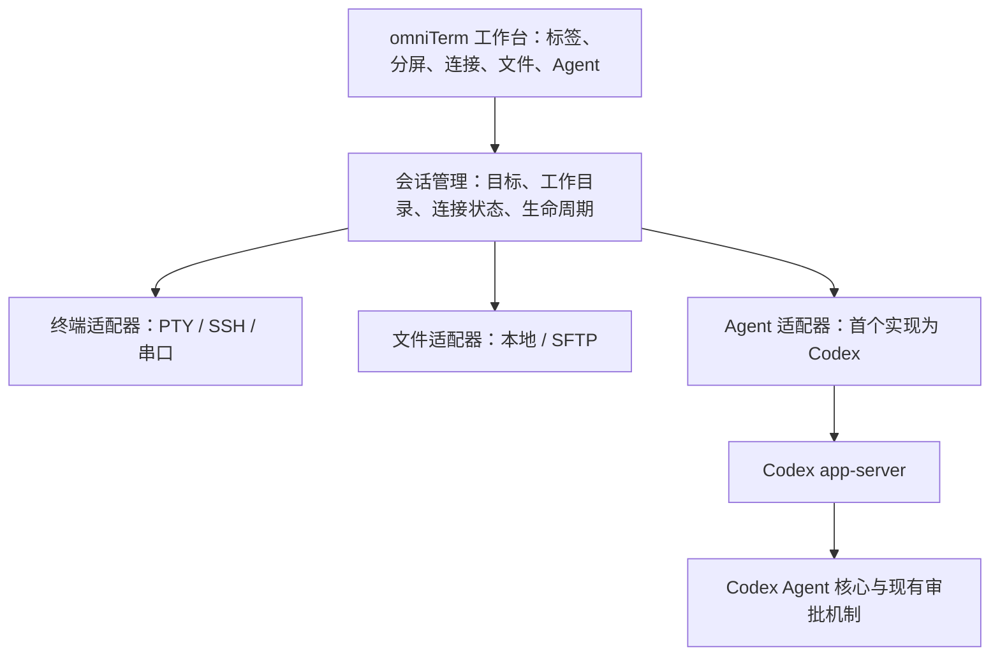

# omniTerm 架构

omniTerm 的目标是把日常终端、远程连接和 Agent 工作流放进同一个跨平台工作台。终端交互体验以 iTerm2 为参考，远程运维工具覆盖以 MobaXterm 为参考；首个 Agent 引擎使用本仓库的 Codex。

本文区分已经继承的代码能力与计划中的产品架构。这里的架构图不是已发布功能清单，具体里程碑见 [roadmap.md](roadmap.md)。

## 现有基础

| 模块              | 仓库位置                                                                                                         | 可复用能力与边界                                                                           |
| ----------------- | ---------------------------------------------------------------------------------------------------------------- | ------------------------------------------------------------------------------------------ |
| omniTerm 命令入口 | [`omniterm-cli`](../../omniterm-cli)                                                                             | Node.js 22+ 的轻量启动器；统一启动 Agent、shell、SSH、SFTP、转发与串口客户端，不提供 GUI。 |
| Codex CLI / TUI   | [`codex-rs/cli`](../../codex-rs/cli)、[`codex-rs/tui`](../../codex-rs/tui)                                       | 交互式 Agent、命令行执行与会话入口；它本身不是桌面终端模拟器。                             |
| Agent 服务        | [`codex-rs/app-server`](../../codex-rs/app-server)、[`app-server-protocol`](../../codex-rs/app-server-protocol)  | 初始化、线程、回合、事件流和审批协议；外部客户端可使用 stdio / WebSocket 传输。            |
| Agent 核心        | [`codex-rs/core`](../../codex-rs/core) 及相关 crate                                                              | 模型交互、工具执行、上下文、配置及现有权限机制。                                           |
| PTY 与进程        | [`codex-rs/utils/pty`](../../codex-rs/utils/pty)                                                                 | 交互式进程、输入输出、窗口尺寸、终止及退出状态；含 Unix PTY 与 Windows ConPTY 实现。       |
| 平台执行与隔离    | [`codex-rs/sandboxing`](../../codex-rs/sandboxing)、[`windows-sandbox-rs`](../../codex-rs/windows-sandbox-rs) 等 | 复用现有平台能力；不能据此宣称远程 SSH 或串口操作已获得同等隔离。                          |

保留 `codex-*` crate、协议字段和兼容性名称，产品名称使用 **omniTerm**。内部模块名的全面替换会扩大上游合并和协议兼容成本，不是建立产品品牌的前提。

首个启动器没有 npm 运行时依赖。`agent` 使用 `OMNITERM_CODEX_BIN`、本仓库构建产物或 PATH 中的 Codex；`shell` 使用系统 shell；`ssh`、`sftp` 和 `tunnel` 调用系统 OpenSSH。`tunnel` 使用 `ssh -N -o ExitOnForwardFailure=yes`，转发参数交给 OpenSSH。`serial` 使用可选的 Python / pyserial miniterm；`doctor` 用于检查本机依赖。命令入口复用已有程序，不等同于内建协议栈、连接管理器或文件管理器。

## 目标分层

桌面 UI、会话管理和终端适配器是待建设的产品层。桌面框架与终端渲染组件应通过三平台原型验证后确定，重点检查输入法、Unicode、长输出、快捷键和可访问性。不要把某个平台的原型等同于跨平台发布。

### 终端与连接

每个会话拥有稳定 ID、类型、明确的执行目标、状态与进程或连接句柄。连接配置和运行状态分离，关闭标签时能清理所属进程、隧道和文件传输。

- **本地终端：** 基于 PTY 接入用户 shell，支持尺寸同步、输入输出和退出状态；终端渲染、滚屏和分屏由产品层实现。
- **SSH：** 首个命令入口调用系统 OpenSSH，保留已有 SSH 配置、密钥代理和主机密钥校验行为。连接管理器随后提供可编辑配置、跳板机和断线状态。
- **端口转发：** 区分本地、远程和动态转发。显示监听地址、监听端口和目标，提供启动失败与停止反馈；不能仅以子进程存在判断隧道可用。
- **SFTP：** 首个命令入口调用系统客户端，后续实现目录浏览、传输进度、取消、冲突处理和失败重试。SFTP 文件操作与终端执行保持独立状态。
- **串口：** 管理设备路径、波特率、数据位、停止位、校验位和流控。设备断开、被占用或无权限时显示可操作错误；日志记录应由用户选择开启。

SSH 主机密钥校验不能静默关闭。连接配置引用系统凭据存储或密钥路径，不把密码、私钥和令牌写进仓库或普通配置导出文件。

### Agent 集成

第一阶段通过 `omniterm agent` 使用现有 Codex CLI/TUI 作为 Agent 入口。未来工作台通过独立的 Codex 适配器连接 `codex app-server`，避免让 UI 直接依赖 Agent 核心内部结构。

根据仓库现有 [协议定义](../../codex-rs/app-server-protocol/src/protocol/common.rs)，适配器需要处理初始化、`thread/start` / 恢复线程、`turn/start`、增量通知、取消和服务端审批请求。优先采用本地子进程的 stdio 连接，并把引擎版本与协议版本一起纳入兼容性检查。实验性接口只在明确启用和测试后使用。

Agent 模式应让用户明确知道：

1. 当前操作针对哪台主机、哪个目录和哪个会话。
2. 哪些选中输出、文件或终端上下文会交给模型。
3. 哪条命令或文件修改正在等待审批、执行、完成或失败。
4. 如何中断任务，以及中断后哪些外部操作可能已经完成。

打开 SSH 标签并不意味着本地 Codex 自动获得远程文件系统或远程执行能力。远程 Agent 必须作为独立里程碑实现，明确选择远端运行引擎或受控远程工具适配方式，并验证审批、目录映射和取消行为。不要把终端输出中的文本直接当成用户授权或可信指令。

后续引擎可以实现同一个产品侧适配接口，但不同引擎的认证、模型选择和权限语义需要分别声明，不能假定完全兼容。

## 跨平台边界

目标系统为 macOS、Linux 和 Windows 原生环境。Windows 的 WSL 连接可以作为额外会话类型，不能替代原生 Windows 的验收。

产品层需要统一会话状态和操作语义，同时保留平台差异：shell 发现、进程组和信号、ConPTY 可用性、路径格式、SSH 客户端安装、串口权限、系统凭据存储及安装包签名。现有源码包含平台实现，不代表 omniTerm 已完成三平台构建和端到端验证。

## 开源与上游关系

项目沿用 [Apache-2.0](../../LICENSE)，保留 [NOTICE](../../NOTICE) 与第三方许可。omniTerm 是基于 OpenAI Codex 的独立项目；继承源码与品牌、托管服务、账号权益应分别说明。

上游历史和内部命名用于追踪来源与后续同步。面向用户的文档、发行物和连接工作台逐步采用 omniTerm 品牌；上游专属发布、签名和组织自动化需要先适配，再由 omniTerm 启用。
