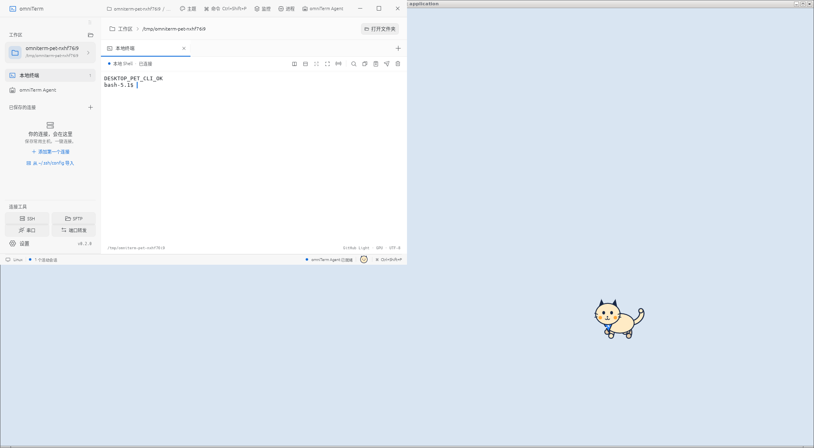
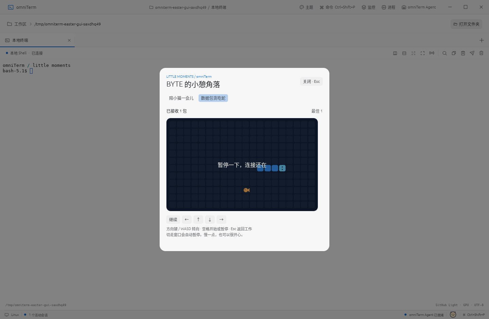

# BYTE · Little moments

先完成角色图画，再实现原生交互。创意方向是「小动物陪伴 + 一个隐藏小游戏」。MobaXterm 的[企鹅屏保与小游戏](https://mobaxterm.mobatek.net/documentation.html)提供了终端也可以有趣的灵感；BYTE 的形象、素材和交互为 omniTerm 新设计。


## 图画

奶油色小猫、藏蓝轮廓、橘色脸颊，蓝色 `>_` 围巾。三种互动姿态：抱着笔记本打盹、抬爪回应摸摸、跳起接住小鱼干数据包。桌面小猫采用保留相同配色与围巾的连续关节动画；四帧奔跑图集保留为先前的设计参考。

透明素材为 [byte-sprites.png](../../../omniterm-native/assets/easter-eggs/byte-sprites.png)，运行时按透明间隔取三帧。图片只解码一次，上传前按渲染器的最大纹理尺寸适配；深浅主题共用透明底，卡片和文字使用当前主题色。

设计图与透明素材由内置 image_gen 生成，提示词见[素材记录](../../../omniterm-native/assets/easter-eggs/prompts.md)。未使用 CLI/API fallback。

## 发现与互动

- 连续点击标题栏品牌五次，进入「BYTE 的小憩角落」。也可在命令面板搜索 `彩蛋`、`BYTE`、`摸鱼` 或 `snake`。
- 点猫咪或「摸摸脑袋」，小猫抬爪回应；「投喂小鱼干」展示追逐动作；可以让它回去打盹。
- 发现后状态栏出现一个小猫入口，右键可隐藏。发现状态、静态插画选项和贪吃蛇最佳成绩保存在原有 UI 状态文件中。
- 数据包贪吃蛇：方向键/WASD 转向，空格开始/暂停，按钮也可操作，Esc 关闭。离开窗口或切换到猫咪页会暂停。

## 整个桌面的追逐

在猫咪页点击「放到桌面追鼠标」，BYTE 会离开小憩面板，成为独立的透明置顶桌宠。鼠标移到其他应用或 omniTerm 窗口外，它也会追过去；主窗口失焦、最小化后仍继续。靠近鼠标约 95 个逻辑点时停下，转向时平滑调整姿态，闲置后逐渐打盹。

- 点击穿透整块桌宠窗口，不抢键盘焦点、不改变鼠标位置；暂停和收回在小憩面板、状态栏小猫的右键菜单中。
- 关闭面板可以继续正常使用终端。主窗口最小化时产生的字形上传保留到恢复后的 GPU 绘制，避免最小化期间执行 CLI 后丢失文字图集。关闭 omniTerm 会同时关闭桌宠；重启后不会自动放出。
- 使用固定的透明 GPU 画布与独立 deferred viewport，猫的位置在画布内以亚像素坐标绘制；不再逐帧拖动系统窗口。画布覆盖桌面，超过 GPU surface 尺寸上限的超宽桌面才使用带滞回的大画布分区。
- 活动时由 wgpu 连续绘制；常规设备保持 VSync，Linux/NVIDIA/Vulkan 在启用桌宠时自动使用异步呈现，动画生产节奏约 120 Hz。暂停或收回后恢复应用原有的 VSync 配置。脚步相位来自实际移动距离，四肢关节、尾巴、身体起伏、转向与入睡都连续插值；停止后降低刷新，暂停后停止轮询。
- 全局鼠标采样在独立 Rust 线程中约 125 Hz 运行，仅鼠标或桌面范围变化时唤醒桌宠；Linux 的屏幕几何缓存一秒，渲染热路径没有同步 X11 往返。
- 面板显示应用实际选择的 GPU / 软件适配器及后端，方便确认当前是否使用硬件加速。
- Windows 使用 `GetCursorPos` / 虚拟桌面范围；macOS 使用 Quartz 全局位置与显示器范围；Linux 使用 X11 `QueryPointer`。没有键盘钩子、事件注入或远程连接操作。
- Linux 需要 X11 和窗口合成器。Wayland 不提供此实现所需的全局坐标与任意定位，界面会说明暂不支持。Windows/macOS 代码由各平台 CI 编译检查；真实 GUI 验证目前在 Linux X11 完成。
- 桌面动作由 [pet_rig.rs](../../../omniterm-native/src/ui/pet_rig.rs) 的 Rust 关节曲线生成，经 egui 网格化后由 wgpu 绘制。[byte-run.png](../../../omniterm-native/assets/easter-eggs/byte-run.png) 保留为旧版设计参考，面板插画仍使用原透明图集。



## 与工作区相处

- 游戏只有独立的本地状态，没有后端、SSH、SFTP 或文件操作接口。
- 浮层打开时主终端及停靠终端不接收键盘输入；关闭帧仍拦截输入，直到已按下的键全部松开。
- 游戏控制键先消费，再绘制按钮，避免空格同时暂停和激活按钮。
- 未放出桌宠时，浮层关闭后没有动画刷新定时器。静态插画选项控制面板呼吸动画；桌宠可单独暂停。
- 小窗口使用滚动区域容纳内容，保留退出按钮；游戏食物只生成在空格，满盘后进入完成状态。

## 原生窗口预览





## 已完成的验证

- 原生单测：168 通过，12 项既有专用服务测试在普通单测中忽略。新增 16 项覆盖游戏成长、反向输入、腾空尾格、碰撞、暂停、满盘获胜、入口、透明素材、1024/2048 纹理上限、最小窗口控件可见性、空格消费及关闭时的按键释放保护，以及桌面追逐的停止距离、缩放、负坐标和边缘限制、从外部按钮重新打开面板时的点击保护、30/60/144 Hz 下的加速一致性、GPU 画布尺寸限制与掉帧后的运动限步。
- release 构建和 all-targets clippy（warnings denied）通过。
- 独立 Xvfb + 临时配置的真实原生窗口验证：五连击、命令面板搜索 BYTE、摸摸/喂食、亮暗主题、开始/暂停、得分、失焦暂停、正常退出和最佳成绩保存。
- 游戏期间按 WASD/空格/Enter、关闭时继续按住 W，终端输出序号保持 2127，增量输出为空；释放按键后 tracked exec 输出 AFTER_EASTER_OK，exitCode 为 0。
- 彩蛋仍打开时 tracked exec 输出 WORK_CONTINUES_OK，exitCode 为 0。测试仅使用隔离的本地 bash，无真实资产、凭据或模型请求。

- 桌宠 GUI 回归：真实 Openbox + xcompmgr + Xvfb 验证跨应用追逐、置顶、不抢焦点、主窗口最小化后继续、暂停/恢复、点击穿透、透明底、收回/再放出，以及退出时一起关闭。运行中的外部 CLI tracked exec 输出 `DESKTOP_PET_CLI_OK`，exitCode 为 0。

复现桌宠回归（只启动临时桌面和配置，不连接真实资产）：

```bash
python3 omniterm-native/scripts/test-desktop-pet.py \
  --binary omniterm-native/target/release/omniterm-app \
  --xvfb /path/to/Xvfb --compositor /path/to/xcompmgr \
  --wm /path/to/openbox --output /tmp/omniterm-pet-check
```

解包运行 Openbox 时，可用 `LD_LIBRARY_PATH` 指向解包的库目录、`XDG_DATA_DIRS` 指向解包的 `usr/share`，并通过 `--wm-config` 提供 `etc/xdg/openbox/rc.xml`。

## GPU 动画性能探针

```bash
./omniterm-native/target/release/omniterm-app --bench-desktop-pet 10 /tmp/byte-gpu.json
```

这是独立的原生 GPU 小程序，不载入资产、终端或用户配置，使用程序内的模拟目标，不移动系统鼠标。报告包含实际适配器、Vulkan/Metal/DX12 等后端、绘制回调间隔、UI 计算耗时、系统画布移动次数与根窗口刷新次数。启动后一秒作为预热；回调速率不等同于操作系统最终显示帧率，也不包含输入到屏幕的端到端延迟。真实桌面测量结果随此次改动保存。

实测使用连接显示器的 RTX 5090（Vulkan），固定画布 2560×1440。同一连续动画在同步呈现下存在约 60–80ms 的长回调间隔；单窗口对照、暂停采样后仍出现。改为异步呈现与最多两帧排队后，10 秒探针的中位间隔约 8.44ms、99 分位约 9.63ms，没有超过 30ms 的间隔。运动和关节动画还限制单帧推进，防止外部停顿后突然跳位。

自动策略只匹配实测的 Linux/NVIDIA/Vulkan 路径。`OMNITERM_GPU_PRESENT=sync` 可强制保留同步呈现做对照；`OMNITERM_GPU_PRESENT=async` 可显式启用异步呈现。其余环境沿用原有策略。动画生产节奏与显示器实际呈现帧率分别受 GPU、合成器和显示器约束。

`--cycle-pause` 可在探针中自动暂停/恢复一次，验证运行时呈现配置恢复，无需操作系统鼠标：

```bash
./omniterm-native/target/release/omniterm-app --bench-desktop-pet 10 /tmp/byte-gpu-cycle.json --cycle-pause
```

同一二进制、相同 GPU 画布的实测对照（启动一秒后采样）：

| 配置 | 中位回调间隔 | 99 分位 | 超过 30ms 的间隔 |
| --- | ---: | ---: | ---: |
| 同步呈现对照 | 13.31ms | 69.35ms | 10 |
| 自动低延迟策略 | 8.44ms | 9.63ms | 0 |

原始数据：[自动策略](byte-gpu-benchmark.json)、[同步对照](byte-gpu-vsync-control.json)、[暂停恢复](byte-gpu-pause-cycle.json)。暂停恢复探针记录到 `AutoNoVsync → AutoVsync → AutoNoVsync`，并完成一次恢复。
