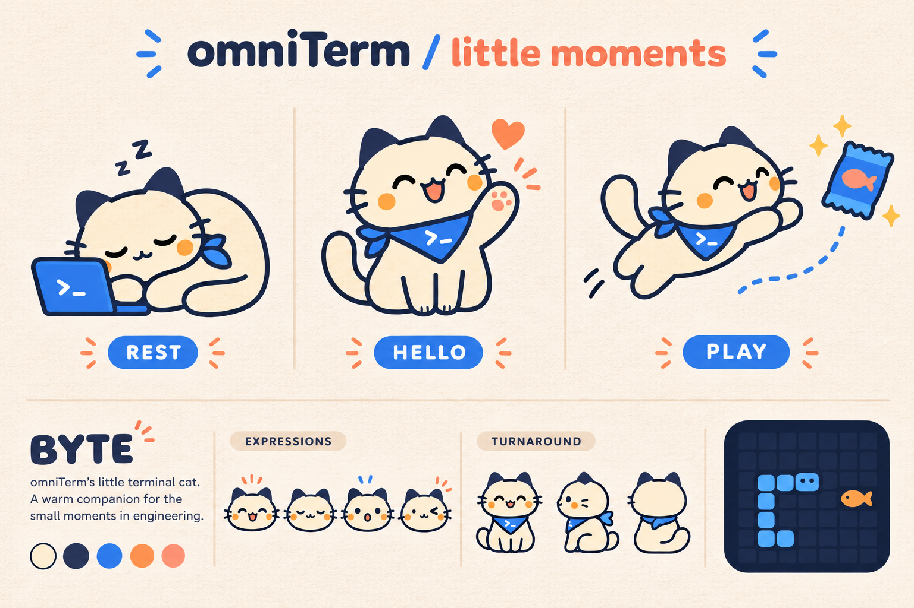
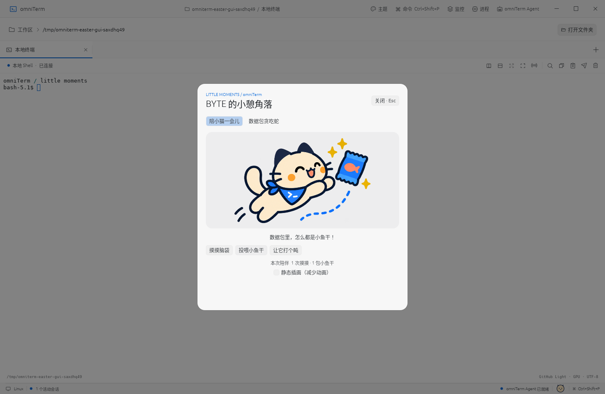
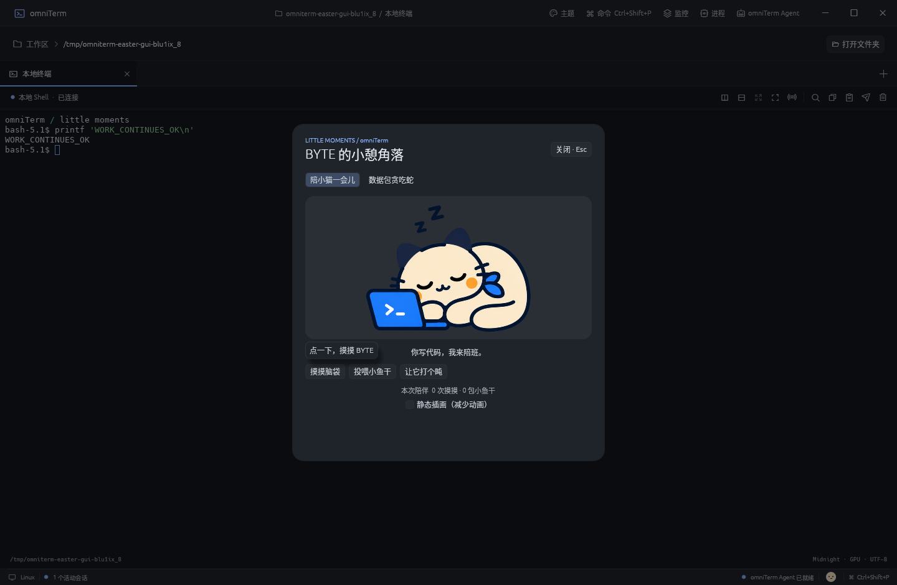

# BYTE · Little moments

先完成角色图画，再实现原生交互。创意方向是「小动物陪伴 + 一个隐藏小游戏」。MobaXterm 的[企鹅屏保与小游戏](https://mobaxterm.mobatek.net/documentation.html)提供了终端也可以有趣的灵感；BYTE 的形象、素材和交互为 omniTerm 新设计。

## 图画

奶油色小猫、藏蓝轮廓、橘色脸颊，蓝色 `>_` 围巾。三种动作：抱着笔记本打盹、抬爪回应摸摸、跳起接住小鱼干数据包。

透明素材为 [byte-sprites.png](../../../omniterm-native/assets/easter-eggs/byte-sprites.png)，运行时按透明间隔取三帧。图片只解码一次；深浅主题共用透明底，卡片和文字使用当前主题色。

设计图与透明素材由内置 image_gen 生成，提示词见[素材记录](../../../omniterm-native/assets/easter-eggs/prompts.md)。未使用 CLI/API fallback。

## 发现与互动

- 连续点击标题栏品牌五次，进入「BYTE 的小憩角落」。也可在命令面板搜索 `彩蛋`、`BYTE`、`摸鱼` 或 `snake`。
- 点猫咪或「摸摸脑袋」，小猫抬爪回应；「投喂小鱼干」展示追逐动作；可以让它回去打盹。
- 发现后状态栏出现一个小猫入口，右键可隐藏。发现状态、静态插画选项和贪吃蛇最佳成绩保存在原有 UI 状态文件中。
- 数据包贪吃蛇：方向键/WASD 转向，空格开始/暂停，按钮也可操作，Esc 关闭。离开窗口或切换到猫咪页会暂停。

## 与工作区相处

- 游戏只有独立的本地状态，没有后端、SSH、SFTP 或文件操作接口。
- 浮层打开时主终端及停靠终端不接收键盘输入；关闭帧仍拦截输入，直到已按下的键全部松开。
- 游戏控制键先消费，再绘制按钮，避免空格同时暂停和激活按钮。
- 浮层关闭时没有动画刷新定时器。静态插画模式可减少动画。
- 小窗口使用滚动区域容纳内容，保留退出按钮；游戏食物只生成在空格，满盘后进入完成状态。

## 原生窗口预览

## 已完成的验证

- 原生单测：161 通过，12 项既有专用服务测试在普通单测中忽略。新增 9 项覆盖游戏成长、反向输入、腾空尾格、碰撞、暂停、满盘获胜、入口、最小窗口控件可见性、空格消费及关闭时的按键释放保护。
- release 构建和 all-targets clippy（warnings denied）通过。
- 独立 Xvfb + 临时配置的真实原生窗口验证：五连击、命令面板搜索 BYTE、摸摸/喂食、亮暗主题、开始/暂停、得分、失焦暂停、正常退出和最佳成绩保存。
- 游戏期间按 WASD/空格/Enter、关闭时继续按住 W，终端输出序号保持 2127，增量输出为空；释放按键后 tracked exec 输出 AFTER_EASTER_OK，exitCode 为 0。
- 彩蛋仍打开时 tracked exec 输出 WORK_CONTINUES_OK，exitCode 为 0。测试仅使用隔离的本地 bash，无真实资产、凭据或模型请求。
