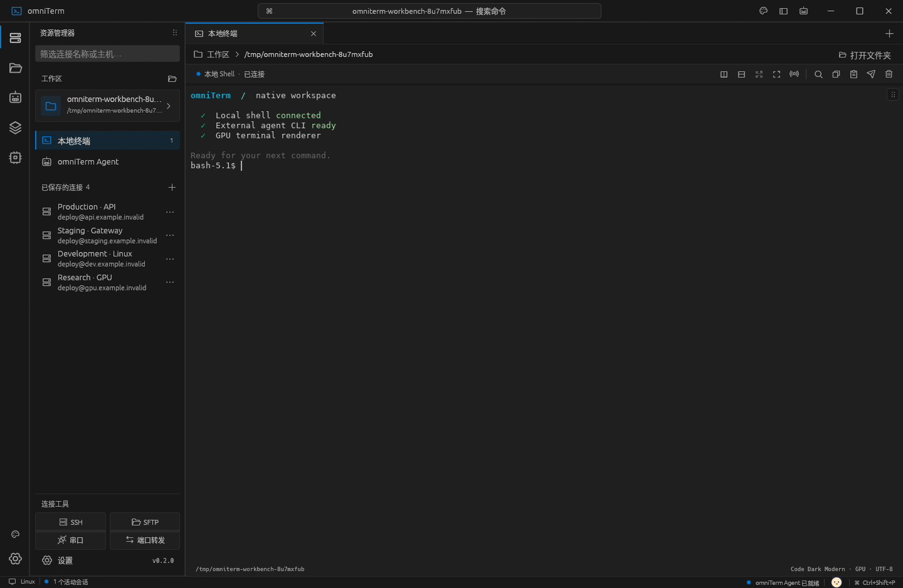
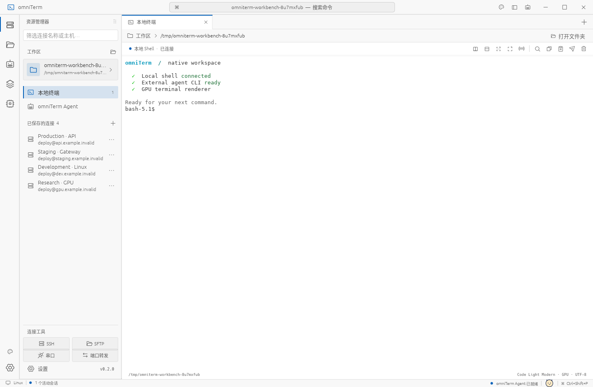
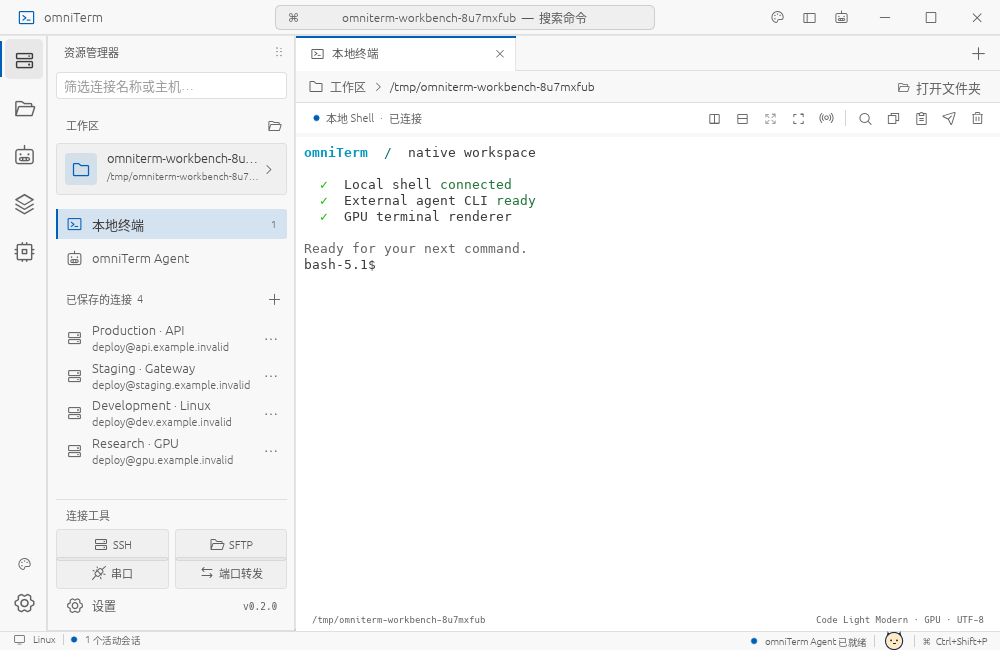

# Native workbench refresh

The native workbench takes its layout cues from VS Code's [activity bar](https://code.visualstudio.com/api/ux-guidelines/activity-bar), [sidebars](https://code.visualstudio.com/api/ux-guidelines/sidebars), and [semantic theme colors](https://code.visualstudio.com/api/references/theme-color). The omniTerm brand, Phosphor icons, terminal engine, docking model and companion remain its own.

## Layout and interaction

- 36 px draggable title bar with a bounded command centre. It opens the existing command palette; layout buttons, theme picker and native window controls stay separate at 1000 × 650.
- 48 px activity bar: workspace/connections, remote files, Agent, monitors and processes. Settings and themes stay reachable when the sidebar is closed or docked elsewhere. With no remote selected, the file button explains how to select one.
- 248 px default sidebar with a connection filter (name, host, username and summary), profile count, selected-asset indication, and restrained 3 px corners. Existing connection menus and panel dragging still work.
- 35 px terminal tabs, with the active accent along the top; 32 px breadcrumbs and a 30 px terminal toolbar. This restores 51 px of vertical terminal space including title/status/footer changes.
- SFTP keeps real navigation and transfer operations, with a path field, a name/size header and 28 px selectable rows. The CLI and the page share the existing connection and operation state.

## Themes

New installations default to `codeDark`. Existing settings retain their chosen theme; all 13 previous themes remain available. The title bar and activity bar both expose the theme picker, with the new presets first. Theme changes persist through the existing settings store.

`codeDark` and `codeLight` adapt [Dark Modern](https://github.com/microsoft/vscode/blob/main/extensions/theme-defaults/themes/dark_modern.json) and [Light Modern](https://github.com/microsoft/vscode/blob/main/extensions/theme-defaults/themes/light_modern.json). Terminal ANSI colors and workbench roles are separate: cursor color does not determine the accent, and sidebar/input backgrounds are independent of the terminal background. UI text and secondary text meet 4.5:1 contrast on the preset backgrounds. Theme attribution is in `omniterm-native/assets/theme-licenses/VSCode-MIT.txt` and must accompany distributions.

Platform UI fonts use the first available preference, with CJK and icon fallbacks. Window translucency/background images continue through the existing shared veil.

## Verification

`omniterm-native/scripts/test-workbench.py` runs the actual native window in a separate Xvfb/Openbox desktop with fake saved profiles. It exercises the external CLI, command centre, theme persistence, connection filtering, sidebar visibility, and minimum window size, and captures dark/light/compact screenshots. It never opens an example asset.

Use `test-web-authorized-sftp.py --cli-gui` with `OMNITERM_TEST_THEME=codeDark` or `codeLight` to exercise the real file page and CLI against its isolated loopback fixture. Keep the desktop companion regression (`test-desktop-pet.py`) for follow/pause/recall, focus, transparency and turn rendering.

Verified on Linux X11: release build and all-targets clippy with warnings denied; 170 native tests passed, with 12 dedicated service tests ignored in the ordinary suite. The workbench GUI fixture, dark/light SFTP fixtures (including full external CLI transfers), and the desktop companion fixture passed. The existing temporary-executable SSH fixture intermittently returned ETXTBSY in a parallel test run; the complete serial run passed. Windows/macOS rendering remains subject to platform validation.
